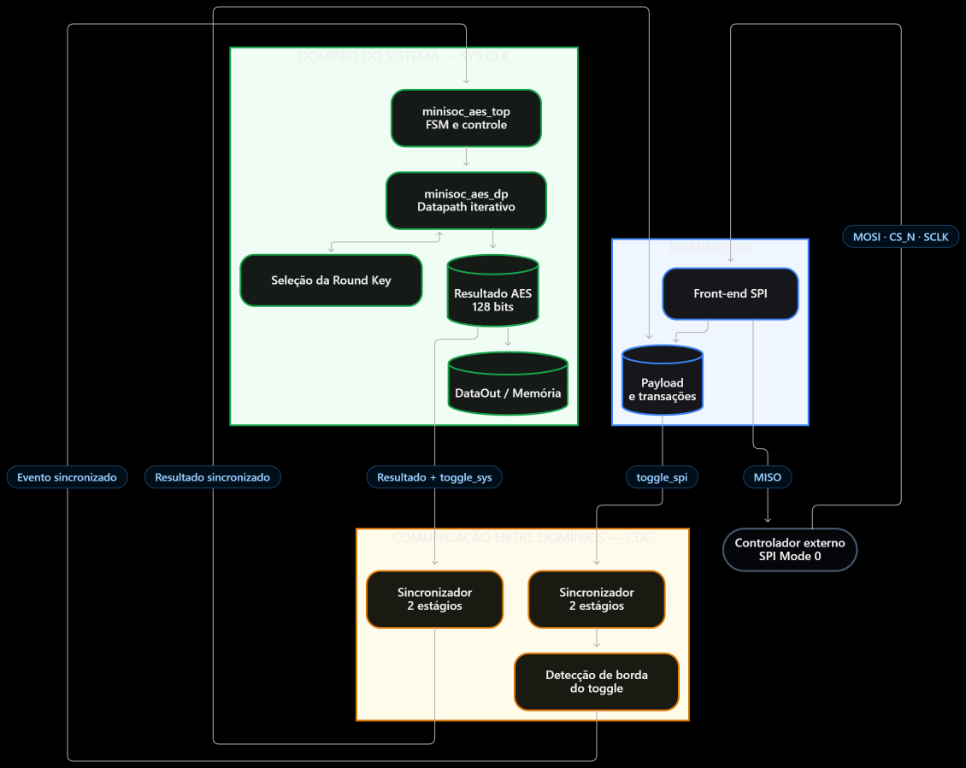
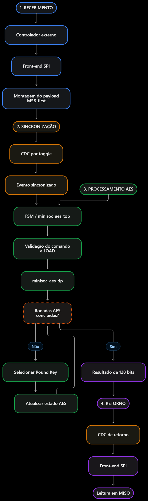
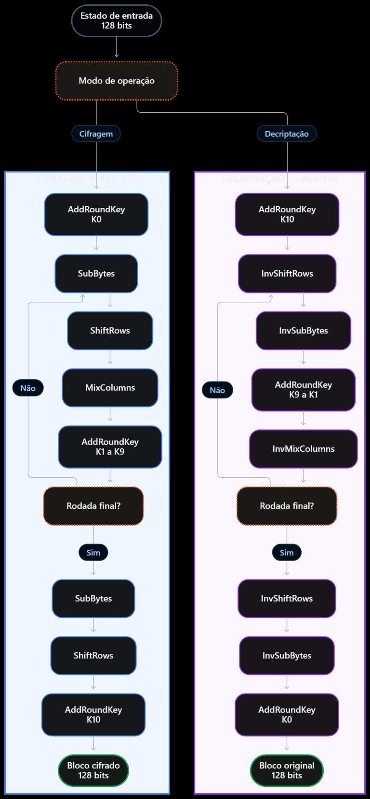
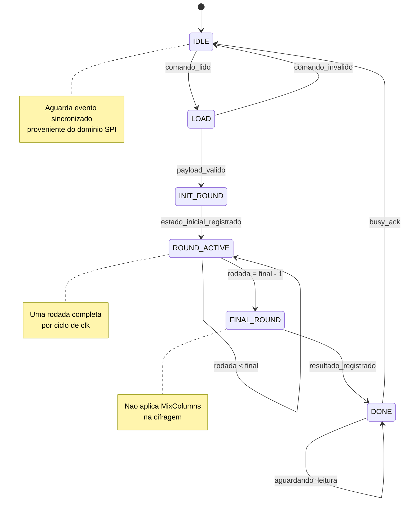

# Microarquitetura do MiniSoC AES - v1.0

| Campo | Informação |
| --- | --- |
| Projeto | MiniSoC AES com interface SPI |
| Semana | 03 |
| Versão | 1.0 |
| Autor | Emilieny De Souza Silva |
| Arquitetura | Iterativa, uma rodada por ciclo |

## 1. Objetivo

Este documento descreve a organização interna proposta para o núcleo AES e define a interface entre a lógica SPI e o datapath. Ele complementa o Block Guide sem redefinir os sinais, registradores ou protocolos fixados pelo documento oficial.

## 2. Visao geral do sistema



### 2.1 Fluxo de controle



## 3. Arquitetura do AES

Foi adotada uma arquitetura iterativa com uma rodada completa por ciclo de clock. Essa opção reduz área e consumo de lógica combinacional, em comparação com uma arquitetura desenrolada, por exemplo.

### 3.1 Estado

O bloco de 128 bits é armazenado em um registrador de estado. A convenção mantida em todos os módulos é:

- Byte 0: `state[127:120]`.
- Byte 15: `state[7:0]`.
- Byte `n`: `state[127-(8*n) -: 8]`.
- A palavra 0 contém os bytes 0 a 3 e ocupa `state[127:96]`.

### 3.2 Datapath iterativo

O estado inicial recebe `AddRoundKey` com a chave de entrada. Em cada rodada principal, o caminho de cifragem executa:

```text
SubBytes -> ShiftRows -> MixColumns -> AddRoundKey
```

Na rodada final, `MixColumns` não é aplicada. Após 10 rodadas do AES-128, o registrador contém o bloco cifrado.

O caminho de decriptação inicia com `AddRoundKey` usando K10. Em seguida, para cada rodada intermediária, executa as operações inversas nesta ordem:

```text
AddRoundKey -> InvShiftRows -> InvSubBytes -> InvMixColumns
```



A rodada final inversa aplica `AddRoundKey`, `InvShiftRows` e `InvSubBytes`, sem `InvMixColumns`.

### 3.3 Transformacoes implementadas

| Transformação | Módulo | Tipo | Status |
| --- | --- | --- | --- |
| SubBytes | `minisoc_aes_sub_bytes` | Combinacional | Implementada |
| ShiftRows | `minisoc_aes_shift_rows` | Fios/reordenação | Implementada |
| MixColumns | `minisoc_aes_mix_columns` | GF(2^8) | Implementada |
| AddRoundKey | `minisoc_aes_add_round_key` | XOR | Implementada |
| InvSubBytes | `minisoc_aes_inv_sub_bytes` | Combinacional | Implementada |
| InvShiftRows | `minisoc_aes_inv_shift_rows` | Fios/reordenação | Implementada |
| InvMixColumns | `minisoc_aes_inv_mix_columns` | GF(2^8) | Implementada |

### 3.4 Round key

A round key é selecionada pelo controlador da FSM:

- Cifragem: índice de 0 até 10.
- Decriptação: índice de 10 até 0.

O datapath não deve iniciar uma nova operação enquanto a round key necessária não estiver disponível.

## 4. FSM de `minisoc_aes_top`

A FSM principal deve seguir os estados funcionais abaixo:

```text
IDLE -> LOAD -> INIT_ROUND -> ROUND_ACTIVE -> FINAL_ROUND -> DONE
```



| Estado | Comportamento |
| --- | --- |
| `IDLE` | Aguarda comando válido do front-end SPI. |
| `LOAD` | Carrega estado, chave e modo selecionado. |
| `INIT_ROUND` | Aplica AddRoundKey inicial ou final, conforme cifragem/decriptação. |
| `ROUND_ACTIVE` | Executa uma rodada por ciclo e atualiza o registrador de estado. |
| `FINAL_ROUND` | Executa a última rodada sem MixColumns ou InvMixColumns. |
| `DONE` | Publica o resultado e sinaliza conclusão. |

### 4.1 Cifragem

1. O estado recebe AddRoundKey com a chave original.
2. As nove primeiras rodadas aplicam SubBytes, ShiftRows, MixColumns e AddRoundKey.
3. Na rodada 10, SubBytes, ShiftRows e AddRoundKey são aplicados sem MixColumns.
4. O resultado é registrado como saída cifrada.

### 4.2 Decriptação

1. O estado recebe AddRoundKey com round key 10.
2. As primeiras nove rodadas inversas aplicam, nesta ordem, InvShiftRows, InvSubBytes, AddRoundKey e InvMixColumns.
3. Na última rodada inversa, aplica-se InvShiftRows, InvSubBytes e AddRoundKey sem InvMixColumns.
4. O texto original é registrado como saída decifrada.

## 5. Interface SPI e CDC

O sistema possui o domínio assíncrono de `spi_sclk` e o domínio do relógio do sistema. Barramentos não devem ser transferidos diretamente entre esses domínios.

### 5.1 Protocolo adotado

Conforme o Block Guide:

- SPI Mode 0.
- MOSI é amostrado na borda de subida de `spi_sclk`.
- MISO é atualizado na borda de descida de `spi_sclk`.
- Organização MSB-first.
- Escrita usa uma transação.
- Leitura usa duas transações.

### 5.2 Transferencia por toggle

A transferência do front-end SPI para o domínio do sistema será realizada por sinais temporais:

```text
toggle_spi -> sincronizador de 2 estagios -> deteccao do novo comando
```

- `toggle_spi`: alterna na conclusão de um comando no domínio SPI.
- `sync_toggle`: versão sincronizada de `toggle_spi` no domínio `clk`.
- `toggle_edge`: evento detectado pela diferença entre o estado atual e anterior.
- `spi_payload_valid`: indica que o payload registrado está estável.
- `spi_payload_ack`: confirma o consumo da palavra pelo sistema.

O payload completo deve ser registrado antes da alternância do toggle. O toggle muda somente uma vez por comando válido.

### 5.3 Retorno ao dominio SPI

O resultado é armazenado no domínio do sistema e transferido ao domínio SPI por um handshake equivalente:

```text
toggle_sys -> sincronizador de 2 estagios -> deteccao do novo resultado
```

O front-end recebe o resultado somente quando o handshake confirma que a transferência foi concluída.

## 6. Reset

A sequência de reset proposta é:

```text
RESET ASSERT -> DOMINIOS ZERADOS -> RESET RELEASE
             -> FSM IDLE -> HANDSHAKE ZERADO -> OPERACOES
```

Devem ser reinicializados explicitamente:

- Registrador de estado.
- Índice da rodada.
- Round key selecionada.
- Estado da FSM.
- Sinal busy.
- Sinal done.
- Resultado publicado.
- Sinais de toggle e ACK.

Nenhum toggle, resultado antigo ou estado busy pode atravessar o reset.

## 7. Controle de atividade

O datapath não processa continuamente. O fluxo é:

1. Receber comando válido.
2. Transferir payload do domínio SPI.
3. Carregar estado, chave e modo.
4. Executar uma rodada por ciclo.
5. Marcar busy durante o processamento.
6. Registrar o resultado.
7. Marcar conclusão.
8. Disponibilizar o resultado ao front-end SPI.

## 8. Verificacao de transformacoes

Os testes unitários verificam:

- Todos os 256 valores da S-box direta.
- Todos os 256 valores da S-box inversa.
- MixColumns da rodada intermediária da FIPS-197, Apêndice B.
- InvMixColumns do estado intermediário correspondente.
- ShiftRows e InvShiftRows dos vetores do Apêndice B.
- SubBytes e InvSubBytes da rodada 1.
- AddRoundKey com round key e estado conhecidos.

Os valores são comparados por palavra de 128 bits e pela convenção de posicionamento deste projeto.
